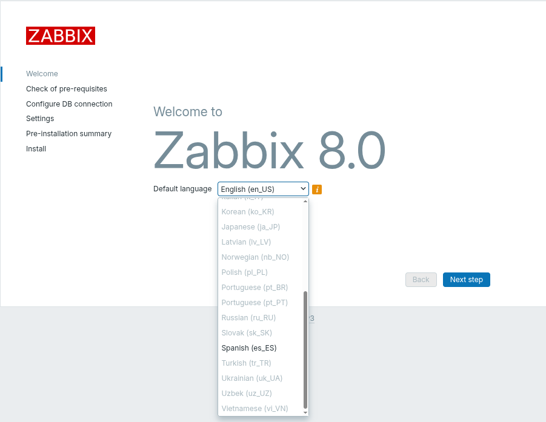
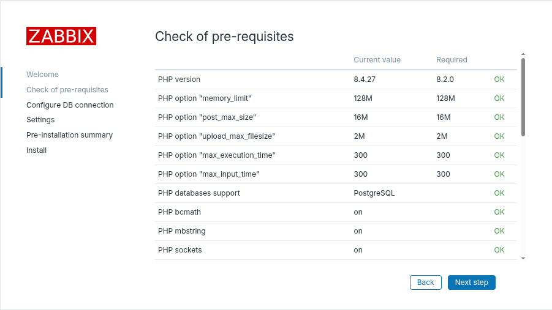
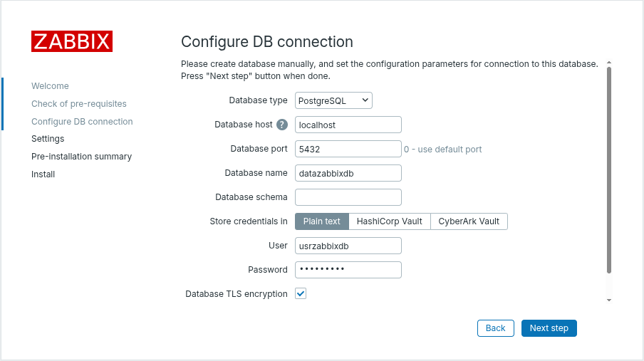
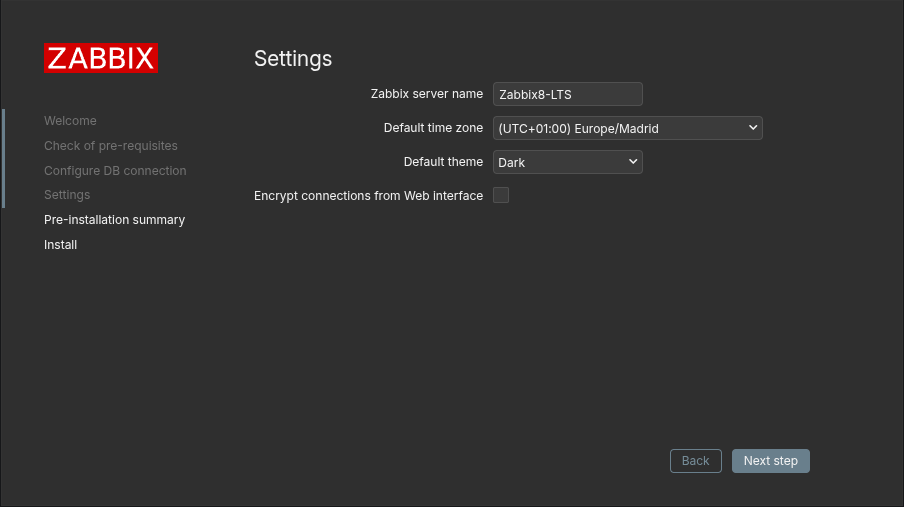
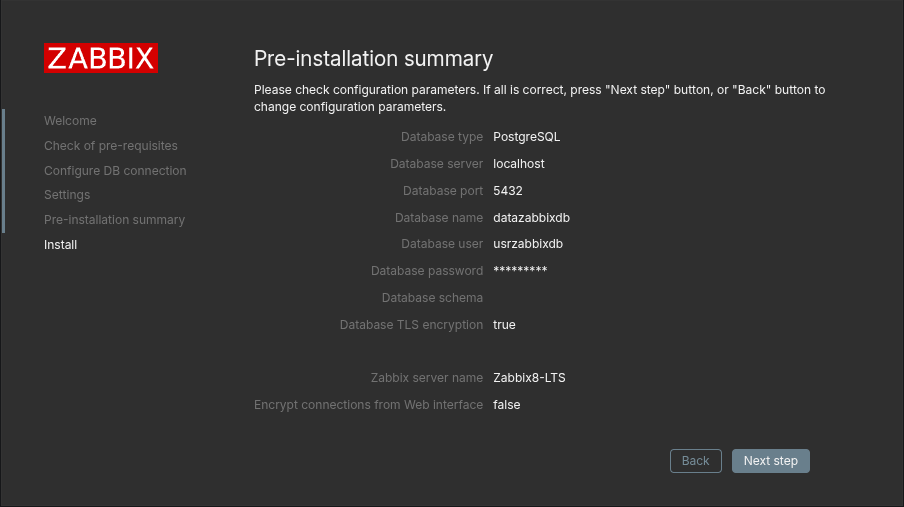
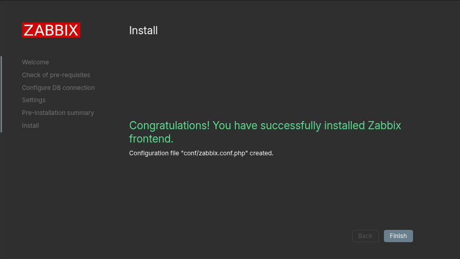
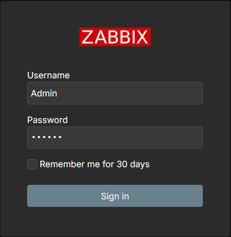
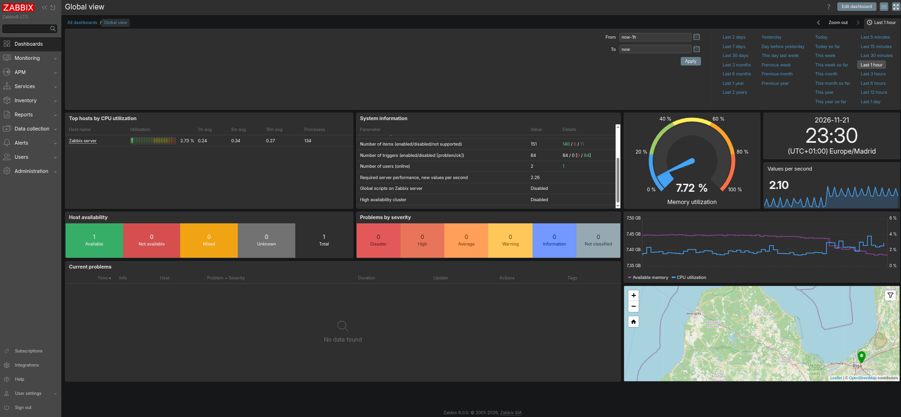

# Zabbix8 LTS on Debian13 install guide
Installation guide for Zabbix 8 LTS monitoring using PostgreSQL + Nginx + TimescaleDB, with an MPC server and new database plugins.
---
<p align="center">
  
</p>

## :book: Index

* 👮 [Terms of use](./LICENSE)
* ♻️ [Features](#recycle-features)
* ✅ [Requirements](#white_check_mark-requirements)
* 📚 [Resources](#books-resources)
* ⚙️ [Install basic software](#gear-install-basic-software)
* 🧰 [Configure PostgreSQL](#toolbox-configure-postgresql)
* 🕛 [Configure TimeScaleDB](#clock12-configure-timescaledb)
* 🛠️ [Configure Zabbix server](#hammer_and_wrench-configure-zabbix-server)
* 🖥️ [Configure Nginx for Zabbix frontend](#desktop_computer-configure-nginx-for-zabbix-frontend)
* 🔗 [Final web server configuration](#link-final-web-server-configuration)
* ⚔️ [Login](#crossed_swords-login)
* 🔭 [Front](#telescope-front)

## :recycle: Features

- Compatible with any Debian-based distribution
- The most powerful build you can make of Zabbix
- PostgreSQL is among the top databases
- TimeScaleDB will speed up PostgreSQL and compress the database
- Nginx is among the top web servers
- Database installation on a separate disk
- Guide 100% compatible with production environments

## :white_check_mark: Requirements

- Basic knowledge of Linux
- Basic knowledge of databases
- One 10GB disk minimal for Debian and another 10GB disk dedicated for PostgreSQL data 
- From 4GB to 16GB of RAM, depending on the environment
- Between 2 and 4 CPU cores, depending on the environment
- Internet connection to install software

## :books: Resources:
-  PostgreSQL DB: https://www.postgresql.org/docs/
-  Zabbix: https://www.zabbix.com/manuals
- TimeScaleDB: https://www.tigerdata.com/docs
- Nginx: https://nginx.org/en/docs/

## :gear: Install basic software 

### Install basic system packages:
```bash
apt update
apt install rsync sudo gnupg curl locales
```

👁️ Now that our normal user has the necessary permissions to carry everything out, we will log out from the root account. If we had a session started with our normal user, we will also log out and log back in so that the sudo group permissions take effect. From this point on, we will no longer use the root user throughout the tutorial

---
### Install PostgreSQL

Debian13 uses PostgreSQL17 by default. If you use another Linux distribution or install the PostgreSQL repositories, the version may be 18. In our guide, stability takes priority over everything else, and this is what Debian recommends
```bash
sudo apt update
sudo apt install postgresql
```
## :toolbox: Configure PostgreSQL 

### Change the database directory to another disk
This step is optional. We recommend separating the database onto another disk for security, management, and performance reasons. By being on a separate disk, it won’t perform writes on the system disk, and if it fills up, it won’t bring the Debian system down.

We have previously created a 20GB disk and mounted it as ext4 at /mnt/storedb

❌ If you don’t want to change the PostgreSQL directory, you can safely skip this step
```bash
sudo systemctl stop postgresql
sudo mkdir -p /mnt/storedb/postgresql/17/main/ # Or the custom path where you want the database to live
sudo rsync -av /var/lib/postgresql/17/main/ /mnt/storedb/postgresql/17/main/ # Or the custom path where you want the database to live
sudo chown -R postgres:postgres /mnt/storedb/postgresql # Or the custom path where you want the database to live
```

Edit data directory:
```bash
 sudo nano /etc/postgresql/17/main/postgresql.conf
```
```bash
data_directory = '/mnt/storedb/postgresql/17/main'  # use data in another directory
```

Start database service:
```bash
sudo systemctl start postgresql
```

### Test new database config:
When executing the command, the new path we created for the database directory should be reflected.
```bash
sudo pg_lsclusters
```
```bash
Ver Cluster Port Status Owner    Data directory              Log file
17  main    5432 online postgres /mnt/storedb/postgresql/17/main /var/log/postgresql/postgresql-17-main.log
```

### Configure database access:
In most step-by-step guides, the credentials are usually zabbix / zabbix. This often creates confusion between the system user, the database user, or even within the command syntax that follows. We have changed the names for a much more secure installation and one that is easier to understand

Create user usrzabbixdb:
```bash
sudo -u postgres createuser --pwprompt usrzabbixdb
```

⚠️ Save the password you set for later use

Create database datazabbixdb:
```bash
sudo -u postgres createdb -O usrzabbixdb datazabbixdb
```

## Install Zabbix server, frontend, Zabbix agent 2, Nginx 

Add Zabbix repository:
```bash
wget https://repo.zabbix.com/zabbix/8.0/release/debian/pool/main/z/zabbix-release/zabbix-release_latest_8.0+debian13_all.deb
sudo dpkg -i zabbix-release_latest_8.0+debian13_all.deb
sudo apt update
```

### Install server packages:
```bash
sudo apt install nginx  zabbix-server-pgsql zabbix-mcp-server zabbix-frontend-php php8.4-pgsql zabbix-nginx-conf zabbix-sql-scripts zabbix-agent2  
```

### Install server plugins
Install the appropriate plugins, depending on the databases to be monitored.
```bash
sudo apt install zabbix-agent2-plugin-mongodb zabbix-agent2-plugin-mssql zabbix-agent2-plugin-postgresql
```

### Install TimeScaleDB plugin:
TimescaleDB is an extension for PostgreSQL that transforms it into a database optimized for time-series data. For Zabbix, it works by automatically splitting large history tables into time-based ‘chunks’, which are invisible to the user but extremely efficient for the system.

Goodbye to slowdowns (efficient Housekeeper): Instead of deleting records one by one (which slows down the server), TimescaleDB removes entire time chunks instantly and with virtually zero CPU cost.

Significant disk savings: It enables native compression that reduces the storage used by historical data by between 60% and 90%.
Consistent performance: It prevents Zabbix from slowing down over time. Read and write speeds for graphs remain fast regardless of database size.

Using TimescaleDB is essential if you are going to monitor a medium or large environment, as it prevents the most common Zabbix bottleneck: database saturation.

Download the repository keys:
```bash
sudo curl -fSL https://packagecloud.io/timescale/timescaledb/gpgkey \
| sudo gpg --dearmor -o /usr/share/keyrings/timescaledb.gpg
```
Install the repository of TimeScaleDB:
```bash
echo "deb [signed-by=/usr/share/keyrings/timescaledb.gpg] https://packagecloud.io/timescale/timescaledb/debian/ trixie main" \
| sudo tee /etc/apt/sources.list.d/timescaledb.list
```
Refresh APT:
```bash
sudo apt update
```
Install TimeScaleDB from APT:
```bash
  apt install timescaledb-2-2.29.3-postgresql-17  timescaledb-2-loader-postgresql-17=2.29.3~debian13-1711
```
## :clock12: Configure TimeScaleDB
Now, with all the software installed on the server, we proceed to its configuration so that all the components fit together perfectly.

### Tune TimeScale for PostgreSQL:
The command sudo timescaledb-tune --quiet --yes is an automatic optimization tool that analyzes your server resources (such as RAM and CPU) and automatically adjusts the parameters of the postgresql.conf file
```bash
sudo timescaledb-tune --quiet --yes
```
Restart database service:
```bash
sudo systemctl restart postgresql
```
Activate TimeScaleDB on datazabbixdb:
```bash
sudo -u postgres psql -d datazabbixdb -c "CREATE EXTENSION IF NOT EXISTS timescaledb;"
```
✔️ CREATE EXTENSION

### Import schema database
```bash
zcat /usr/share/zabbix/sql-scripts/postgresql/server.sql.gz | psql -h localhost -U usrzabbixdb -d datazabbixdb
```
### Execute schema optimization TimeScaleDB:

```bash
 sudo -u postgres psql -d datazabbixdb -f /usr/share/zabbix/sql-scripts/postgresql/timescaledb/schema.sql
```

❌ If you missed any of these steps or something went wrong, the best approach is to drop the database and recreate it following the previous steps
```bash
sudo -u postgres dropdb datazabbixdb
```

Test TimeScaleDB:
This test confirms that TimescaleDB is working in Zabbix because it verifies that the historical tables (such as history or trends) have been converted into hypertables, which is TimescaleDB’s special format for handling time-series data. If these tables appear in the query results, it means the extension is active, properly integrated into the database, and managing automatic time-based partitioning.

```bash
sudo -u postgres psql -d datazabbixdb -c "SELECT * FROM timescaledb_information.hypertables;"
```
💚:Correct result:
```bash
ypertable_schema | hypertable_name |    owner    | num_dimensions | num_chunks | compression_enabled | tablespaces | primary_dimension | primary_dimension_type 
-------------------+-----------------+-------------+----------------+------------+---------------------+-------------+-------------------+------------------------
 public            | history         | usrzabbixdb |              1 |          0 | f                   |             | clock             | integer
 public            | history_uint    | usrzabbixdb |              1 |          0 | f                   |             | clock             | integer
 public            | history_log     | usrzabbixdb |              1 |          0 | f                   |             | clock             | integer
 public            | history_text    | usrzabbixdb |              1 |          0 | f                   |             | clock             | integer
 public            | history_str     | usrzabbixdb |              1 |          0 | f                   |             | clock             | integer
 public            | history_bin     | usrzabbixdb |              1 |          0 | f                   |             | clock             | integer
 public            | history_json    | usrzabbixdb |              1 |          0 | f                   |             | clock             | integer
 public            | auditlog        | usrzabbixdb |              1 |          0 | f                   |             | auditid           | character varying
 public            | trends          | usrzabbixdb |              1 |          0 | f                   |             | clock             | integer
 public            | trends_uint     | usrzabbixdb |              1 |          0 | f                   |             | clock             | integer
(10 rows)
```

# Zabbix 8 and TimescaleDB – Verification Guide

## 1. Check that TimescaleDB is installed

Connect to PostgreSQL:

```bash
sudo -u postgres psql -d zabbix
```

Run the following SQL query:

```sql
SELECT extname, extversion
FROM pg_extension
WHERE extname = 'timescaledb';
```
Expected result:
```text
   extname   | extversion 
-------------+------------
 timescaledb | 2.29.3
(1 row)
```

If the query returns no rows, TimescaleDB is not enabled in that database.

## 2. Check that Zabbix tables are hypertables

This is one of the most important checks.

Run:
```sql
SELECT
    hypertable_name,
    num_chunks
FROM timescaledb_information.hypertables
ORDER BY hypertable_name;
```
```text
 hypertable_name | num_chunks 
-----------------+------------
 auditlog        |          1
 history         |          3
 history_bin     |          0
 history_json    |          0
 history_log     |          0
 history_str     |          3
 history_text    |          0
 history_uint    |          3
 trends          |          1
 trends_uint     |          1
(10 rows)
```

You should find tables such as:
- history
- history_uint
- history_str
- history_text
- history_log
- trends
- trends_uint
Not every installation necessarily has all these tables.

### How to interpret the results
- If the tables appear, TimescaleDB is managing their data partitioning.
- If no tables appear, having the extension installed does not mean Zabbix is actually using it.
- If some tables are missing, the TimescaleDB schema configuration may be incomplete.

## 3. Check that historical data is being inserted
Run:
```sql
SELECT
    'history' AS table_name,
    COUNT(*) AS records
FROM history
UNION ALL
SELECT
    'history_uint',
    COUNT(*)
FROM history_uint
UNION ALL
SELECT
    'trends',
    COUNT(*)
FROM trends
UNION ALL
SELECT
    'trends_uint',
    COUNT(*)
FROM trends_uint;
```
```sql
    table     | records 
--------------+-----------
 history      |     42672
 history_uint |     22271
 trends       |      1047
 trends_uint  |       641
(4 rows)
```
This query checks whether historical records exist in the main Zabbix history and trends tables.

To check the number of chunks per hypertable, run:

```sql
SELECT
    hypertable_name,
    COUNT(*) AS chunks
FROM timescaledb_information.chunks
GROUP BY hypertable_name
ORDER BY hypertable_name;
```

```text
 hypertable_name | chunks 
-----------------+--------
 auditlog        |      1
 history         |      3
 history_str     |      3
 history_uint    |      3
 trends          |      1
 trends_uint     |      1
(6 rows)
```


## 4. Check compression configuration

Run:

```sql
SELECT
    hypertable_name,
    compression_enabled
FROM timescaledb_information.hypertables
ORDER BY hypertable_name;
```
```text
 hypertable_name | compression_enabled 
-----------------+---------------------
 auditlog        | t
 history         | t
 history_bin     | t
 history_json    | t
 history_log     | t
 history_str     | t
 history_text    | t
 history_uint    | t
 trends          | t
 trends_uint     | t
(10 rows)
```

A value of `true` means compression is enabled for that hypertable.

To inspect the configured background jobs and compression policies, run:

```sql
SELECT *
FROM timescaledb_information.jobs;
```

In an installation configured using the official Zabbix TimescaleDB scripts, you may find compression enabled and automatic policies configured to compress older data.

**Important:** Having compression enabled does not necessarily mean that data has already been compressed. Actual compression depends on the configured policies, chunk age, and successful execution of background jobs.


### Skip TimescaleDB version restriction:
⚠️ This step is only necessary if you have installed software versions that Zabbix does not support by default. Use it at your own risk; we include it so you are aware that it exists.
Uncomment and set the AllowUnsupportedDBVersions parameter to 1:
```bash
sudo nano /etc/zabbix/zabbix_server.conf
```
```bash
### Option: AllowUnsupportedDBVersions
#       Allow server to work with unsupported database versions.
#       0 - do not allow
#       1 - allow
#
# Mandatory: no
# Default:
AllowUnsupportedDBVersions=1
```
## :hammer_and_wrench: Configure Zabbix server:
### Configure the database credentials for zabbix server:
Change parameters, in this file, we will add the password for the PostgreSQL user usrzabbixdb that we created earlier
```bash
sudo nano /etc/zabbix/zabbix_server.conf
```
```bash
### Option: DBName
#       Database name.
#
# Mandatory: yes
# Default:
# DBName=
DBName=datazabbixdb

### Option: DBSchema
#       Schema name. Used for PostgreSQL.
#
# Mandatory: no
# Default:
# DBSchema=

### Option: DBUser
#       Database user.
#
# Mandatory: no
# Default:
# DBUser=
DBUser=usrzabbixdb

### Option: DBPassword
#       Database password.
#       Comment this line if no password is used.
#
# Mandatory: no
# Default:
# DBPassword=
DBPassword=YOUR_PASSWORD_DB_USER
```
### Configure language for Zabbix frontend:
For Zabbix to support any language, it must be installed on the operating system. By default, we will install en_US.UTF-8 and es_ES.UTF-8, as they are the most widely used worldwide

:warning: In the language selector, if you want a language other than English, you must install it first on the operating system and then restart the Zabbix and PHP services.
```bash
sudo dpkg-reconfigure locales
```
 Inside the menu, for example select:

```bash
Generating locales (this might take a while)...
  en_US.UTF-8... done
  es_ES.UTF-8... done
Generation complete.
 ```
✔️  Restart terminal session to apply

Then, optionally, you can set it as the system’s default locale:
After that, you can verify it with:
```bash
locale
 ```
```bash
LANG=en_US.UTF-8
LANGUAGE=
LC_CTYPE="en_US.UTF-8"
LC_NUMERIC="en_US.UTF-8"
LC_TIME="en_US.UTF-8"
LC_COLLATE="en_US.UTF-8"
LC_MONETARY="en_US.UTF-8"
LC_MESSAGES="en_US.UTF-8"
LC_PAPER="en_US.UTF-8"
LC_NAME="en_US.UTF-8"
LC_ADDRESS="en_US.UTF-8"
LC_TELEPHONE="en_US.UTF-8"
LC_MEASUREMENT="en_US.UTF-8"
LC_IDENTIFICATION="en_US.UTF-8"
LC_ALL=
 ```
## :desktop_computer: Configure Nginx for Zabbix frontend:
Uncomment the listen and server_name lines with the parameters that will be used in the URL; this can be a DNS name or an IP address:
```bash
sudo nano /etc/zabbix/nginx.conf
```
```bash
server {
        listen          8080;
        server_name     192.168.1.100;
```
Restart web services:
```bash
systemctl restart postgresql zabbix-server php8.4-fpm nginx zabbix-agent2 
```
If after restarting all services any of them fail, review the steps carefully until everything works correctly. On the other hand, if after restarting there are no errors, you will be able to access via the web at http://YOUR_IP:8080 and proceed with the final server configuration.
### 
Enable services: 
```bash
systemctl enable postgresql zabbix-server php8.4-fpm nginx zabbix-agent2 
```
Check ports avaliable:
Make sure that the services are active and listening on the correct port:
```bash
ss -tnlp
```
```bash
State              Recv-Q             Send-Q                         Local Address:Port                          Peer Address:Port            Process                                                                                   
LISTEN             0                  511                                  0.0.0.0:8080                               0.0.0.0:*                users:(("nginx",pid=27577,fd=5),("nginx",pid=27576,fd=5),("nginx",pid=27575,fd=5))       LISTEN             0                  200                                127.0.0.1:5432                               0.0.0.0:*                users:(("postgres",pid=27596,fd=7))                                                      LISTEN             0                  511                                  0.0.0.0:80                                 0.0.0.0:*                users:(("nginx",pid=27577,fd=6),("nginx",pid=27576,fd=6),("nginx",pid=27575,fd=6))       LISTEN             0                  100                                127.0.0.1:25                                 0.0.0.0:*                users:(("master",pid=11203,fd=13))                                                      
LISTEN             0                  4096                                       *:10050                                    *:*                users:(("zabbix_agent2",pid=27607,fd=8))                                                 
LISTEN             0                  4096                                       *:22                                       *:*                users:(("sshd",pid=1356,fd=3),("systemd",pid=1,fd=89))                                   
```


### Initial screen:
Here we configure the language that Zabbix will use by default in the web interface (it can be changed later at any time from the options panel). The languages must be installed beforehand on the operating system in order to be selected (follow the "dpkg-reconfigure locales" section earlier in this guide). If you have not done so, you will need to install the corresponding language and restart the services again.


### Second screen, prerequisites
Zabbix will check that all required components are installed in compatible versions. If you have followed this guide step by step, everything should appear as OK and you will only need to click “Next.” If anything is not OK, review it manually and restart the Zabbix services again.


### Third screen, database connection
Perhaps the most critical screen of the entire setup wizard, here we will enter the database credentials that we created when configuring PostgreSQL and that we added in /etc/zabbix/zabbix_server.conf so that the server’s PHP can connect to the database.
If something is incorrect either in the guide or in the values entered in the fields, it will not allow us to proceed further.

- Database type: PostgreSQL
- Database host: localhost
- Database port: 0 or 5432
- Database name: datazabbixdb
- Database schema: leave empty
- Store credentials in: Plain text
- User: usrzabbixdb
- Password: The password you created when setting up the “usrzabbixdb” user in PostgreSQL
- Database TLS encryption: Activated
  


⚠️ If you have error to fetch DB version your user dont have permisions on the DB, fix with: 
```sql
su -
su - postgres
psql -d datazabbixdb
GRANT CONNECT ON DATABASE datazabbixdb TO usrzabbixdb;
GRANT USAGE ON SCHEMA public TO usrzabbixdb;
GRANT ALL PRIVILEGES ON ALL TABLES IN SCHEMA public TO usrzabbixdb;
GRANT ALL PRIVILEGES ON ALL SEQUENCES IN SCHEMA public TO usrzabbixdb;
```

### Fourth screen, server settings
In this screen, we will configure the server name, the time zone we belong to, and the color theme of the web application. For me, the dark theme will always be the best, but this is a matter of personal preference.

- Zabbix server name: This is the name that will appear in the left sidebar when accessing Zabbix, acting as an identifier in case we have multiple Zabbix servers.
- Default time zone: Time zone to which the server belongs. This field is important because it affects the timestamps of logs and the timeline of events and incidents recorded on the server.
- Default theme: Color theme that the web application will use. Personally, I find the dark theme to be the most suitable, but this ultimately comes down to personal preference.



### Fifth screen, Summary
This screen is simply a summary of everything we have entered in the wizard before clicking the final confirmation button, with a particular focus on the information provided in the database connection section.



### Sixth and final screen, we are done
If everything has gone correctly, our server is now ready for use and has created the file /etc/zabbix/web/zabbix.conf.php with all the parameters we entered in the wizard. 
Congratulations! I hope you enjoy it a lot 🎉



## :crossed_swords: Login
Now that the installation is complete, we only need to log in to the web application using the default Zabbix credentials.

- User: Admin
- Pass: zabbix



## :telescope: Front
From this point on, a world of endless possibilities and deep control over our infrastructure begins. We strongly recommend changing the default credentials of the web Admin user, adjusting the profile, customizing the frontend widgets, and creating users with roles tailored to each use case depending on who will manage the system. Security can never be taken too seriously, and the information handled by monitoring systems is often highly sensitive.




## MCP server config

### Add repository
Only perform this step if the Zabbix server installation repositories have not yet been added to the machine.
```bash
wget https://repo.zabbix.com/zabbix/8.0/release/debian/pool/main/z/zabbix-release/zabbix-release_latest_8.0+debian13_all.deb
sudo dpkg -i zabbix-release_latest_8.0+debian13_all.deb
sudo apt update
```

### Install Zabbix MCP server
```bash
sudo apt install zabbix-mcp-server
```

### Configure MCP server
Edit the file /etc/zabbix/zabbix_mcp_server.conf and set the FrontendURL and AllowedIP parameters
```bash
nano /etc/zabbix/zabbix_mcp_server.conf
```
Add new FrontURL line to find zabbix API
```conf
############ ZABBIX API CLIENT PARAMETERS #################

### Option: FrontendURL
#	Zabbix API endpoint URL: the Zabbix frontend URL ending with
#	'api_jsonrpc.php'. Every tool and resource call is forwarded to this
#	address, authenticated with the Zabbix API token supplied by the MCP
#	client.
#	Example: FrontendURL=https://instance.example.com/api_jsonrpc.php
#
# Mandatory: yes
# Default:
# FrontendURL=
FrontendURL=http://127.0.0.1:8080/api_jsonrpc.php
```
Add your host or network access in Allowed IP
```conf
### Option: AllowedIP
#	Incoming connections will be accepted only from the hosts listed here.
#	Comma-delimited list of IP addresses, CIDR networks or DNS names.
#
# Mandatory: yes
# Default:
# AllowedIP=

AllowedIP=127.0.0.1,::1,YOUR-HOST-IP-OR-NETWORK,192.168.1.0/24
```
Restart and enable the services
```bash
sudo systemctl restart zabbix-mcp-server
sudo systemctl enable zabbix-mcp-server
```

### PostgresQL Monitor Plugin server
```bash
sudo -u postgres createuser --pwprompt zbx_monitor
```
```text
Enter password for new role:
******
Enter it again:
******
```

Add permissions  user zbx_monitor to pg_monitor table:
```bash
sudo -u postgres psql -c "GRANT pg_monitor TO zbx_monitor;"
```

reload config
```bash
sudo -u postgres psql -c "SELECT pg_reload_conf();"
```

check permissions:
```bash
sudo -u postgres psql -c "SELECT roleid::regrole, member::regrole FROM pg_auth_members WHERE member = 'zbx_monitor'::regrole;"
```
```bash
  roleid   |   member   
------------+------------
 pg_monitor | zbx_monitor
(1 row)
```

Deberías ver el rol pg_monitor entre sus atributos de pertenencia.

restart agent

Data collection → Hosts

Selecciona el host que representa tu servidor Zabbix.

En Templates, añade:

PostgreSQL by Zabbix agent 2

En Macros, configura:

| Macro | Descripción | Valor |
| :--- | :--- | :--- |
| `{$PG.HOST}` | Hostname or IP of PostgreSQL host. | `localhost` |
| `{$PG.PORT}` | PostgreSQL service port. | `5432` |
| `{$PG.USER}` | PostgreSQL username. | `zbx_monitor` |
| `{$PG.PASSWORD}` | PostgreSQL user password. | `YOUR-zbxagentdb-PASSWORD` |
| `{$PG.DATABASE}` | Default PostgreSQL database for the connection. | `postgres` |
